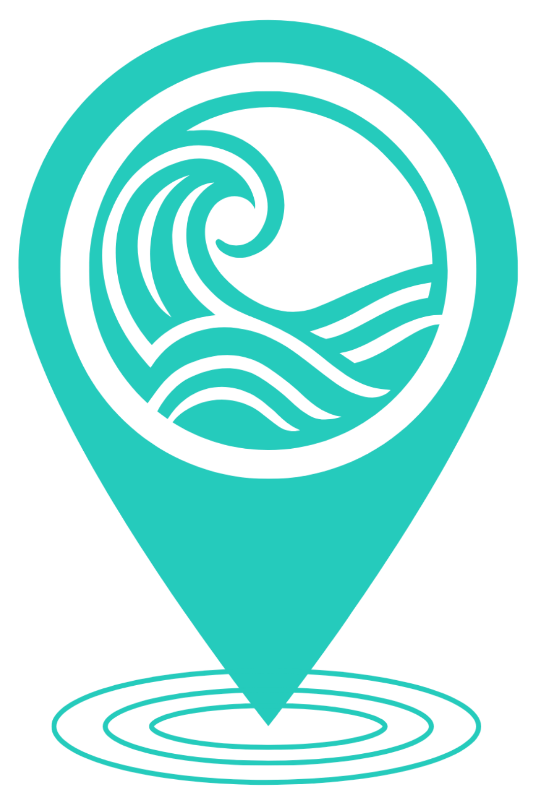
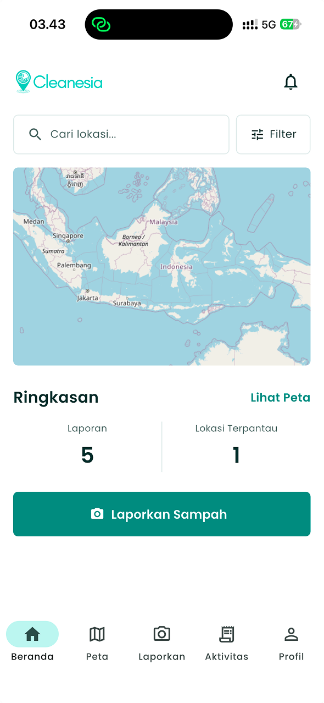
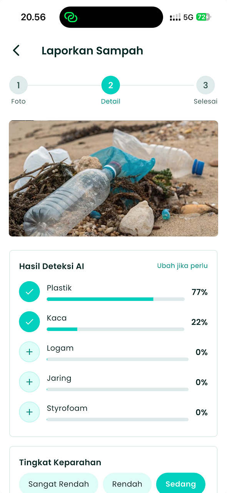
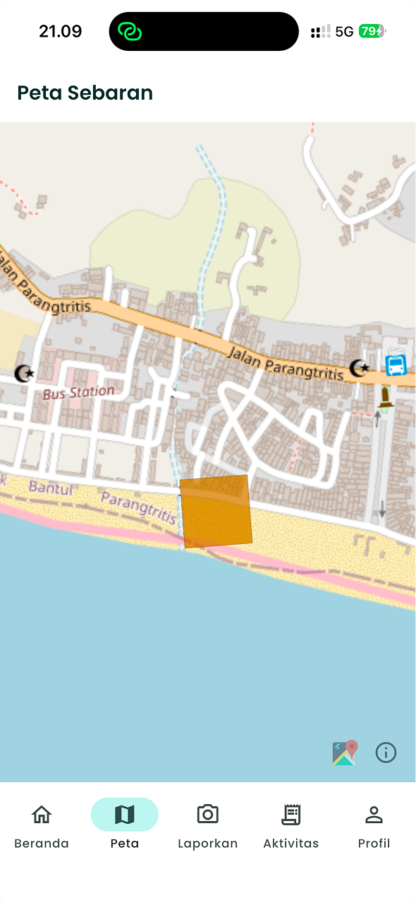

<p align="center">
  
</p>

<h1 align="center">Cleanesia</h1>

<p align="center">
  <b>Aplikasi Pemetaan Sebaran Sampah Laut Berbasis Kecerdasan Buatan dan Partisipasi Warga Pesisir</b>
</p>

<p align="center">
  
  
  
  
  
</p>

---

## Ringkasan

Cleanesia menjadikan warga pesisir sebagai jaringan pelapor terdistribusi untuk memetakan sebaran sampah laut di Indonesia. Warga cukup memotret sampah di pantai, model kecerdasan buatan yang berjalan langsung di ponsel mengenali jenis sampah pada foto tanpa memerlukan koneksi internet. Setiap laporan digabungkan menjadi peta kepadatan per area yang membantu komunitas kebersihan pantai dan pemerintah menentukan lokasi prioritas pembersihan.

Data yang terkumpul dapat dipantau melalui **dasbor web** (peta keparahan, tabel laporan, statistik) yang dilengkapi alat moderasi untuk admin, sehingga pengelola dapat menyaring laporan yang tidak layak tanpa merusak peta.

> Cleanesia berkontribusi pada Tujuan Pembangunan Berkelanjutan (SDG) nomor 14, Ekosistem Lautan, dengan mengurangi hambatan ketersediaan data lapangan dalam pemantauan sampah laut.

---

## Tangkapan Layar


| Layar Beranda | laporan (Deteksi AI) | Peta Sebaran |
|:---:|:---:|:---:|
|  |  |  |

---

## Fitur Utama

- **Klasifikasi jenis sampah di ponsel (offline mode).** Model TensorFlow Lite mengenali lima jenis sampah secara *multilabel* langsung di perangkat, tanpa mengirim foto ke mana pun dan tanpa koneksi internet.
- **Estimasi tingkat keparahan.** Pelapor menetapkan tingkat keparahan pada skala lima tingkat, dengan dukungan koreksi hasil deteksi AI (*human-in-the-loop*).
- **Peta sel keparahan.** Laporan digabung menjadi peta yang menandai keparahan terkini per area, dengan warna yang memudar seiring umur laporan dan penanda abu-abu untuk area yang belum terpantau.
- **Mode offline.** Laporan yang dibuat tanpa sinyal disimpan di antrean lokal dan tersinkron otomatis begitu perangkat kembali daring.
- **Riwayat & status sinkronisasi.** Pengguna dapat memantau laporannya sendiri beserta status "Terkirim" atau "Menunggu sinkron".
- **Lintas platform.** Satu basis kode berjalan di Android dan iOS.
- **Dasbor web pemantauan.** Peta keparahan per sel, tabel dan detail laporan dengan filter, serta statistik (tren, komposisi jenis sampah, distribusi keparahan, area dengan laporan terbanyak). Pemantau masuk dengan Google atau email.
- **Moderasi laporan oleh admin.** Admin dapat menyembunyikan dan memulihkan laporan (misalnya data uji coba, spam, atau lokasi tidak valid). Peta langsung terkoreksi ke laporan terlihat berikutnya, dan laporan yang disembunyikan tetap tampak bagi admin dengan penanda.
- **Pengelolaan peran dan jejak audit.** Admin mengatur peran pengguna dasbor, dan setiap aksi admin tercatat dalam jejak audit yang hanya dapat ditulis server.

---

## Cara Kerja

Arsitektur Cleanesia memisahkan dua lapisan kerja: klasifikasi yang berjalan di ponsel dan agregasi data yang berjalan di server.

<p align="center">
  
</p>

1. **Ponsel (offline mode):** foto diambil, model TFLite mengklasifikasi jenis sampah, pengguna mengoreksi dan menetapkan keparahan, lalu laporan masuk ke antrean lokal.
2. **Sinkronisasi:** saat daring, laporan terkirim otomatis ke Firebase.
3. **Server:** Cloud Firestore menyimpan laporan; Cloud Functions memperbarui data per sel dengan keparahan laporan terbaru; aplikasi membaca data sel yang ringan untuk menampilkan peta.
4. **Dasbor web:** membaca koleksi yang sama langsung dari Firestore. Semua perubahan oleh admin (menyembunyikan laporan, mengubah peran) hanya lewat Cloud Functions *callable* yang memverifikasi peran admin di server; *Security Rules* melarang penulisan langsung ke laporan dan sel.

---

## Model Kecerdasan Buatan

Model dibangun dengan *transfer learning* dari **MobileNetV3-Small**, dilatih pada gabungan dataset publik **TACO** dan **TrashNet**, lalu dikonversi ke **TensorFlow Lite** dengan kuantisasi *float16*.

- **Kelas (multilabel):** Plastik, Styrofoam, Logam, Kaca, Jaring (*ghost gear*)
- **Keluaran:** lima nilai keyakinan *sigmoid* yang independen (tidak berjumlah 100%)
- **Ukuran model:** 1,91 MB

### Hasil Pengujian (data validasi)

| Kelas | Presisi | Recall | F1 |
|---|:---:|:---:|:---:|
| Plastik | 0,76 | 0,89 | 0,82 |
| Kaca | 0,89 | 0,85 | 0,87 |
| Logam | 0,73 | 0,78 | 0,75 |
| Styrofoam | 0,40 | 0,27 | 0,32 |
| Jaring | 0,18 | 0,50 | 0,27 |
| **Rata-rata makro** | | | **0,61** |

### Kecepatan (iPhone 15)

| Tahap | Waktu rata-rata |
|---|:---:|
| Inferensi model | ~68 ms |
| Total per foto (termasuk pra-pemrosesan) | ~249 ms |

> Kelas Styrofoam dan Jaring masih lemah karena keterbatasan contoh pada dataset publik. Pengayaan data lapangan direncanakan untuk pengembangan berikutnya. Mekanisme koreksi manual oleh pelapor berperan sebagai penyaring kualitas sekaligus sumber data pelatihan tambahan.

---

## Logika Peta Sel

- Koordinat tiap laporan dikuantisasi ke **sel grid** 0,001° (~111 m).
- Warna sel = **keparahan laporan terbaru** pada sel itu (bukan rata-rata, bukan jumlah laporan).
- Kesegaran warna **memudar** seiring bertambahnya umur laporan.
- Sel yang melewati ambang basi (21 hari) ditandai **abu-abu (belum terpantau)**.
- Laporan yang **disembunyikan admin** tidak dihitung: sel turun ke laporan terlihat terbaru berikutnya, atau kembali "belum terpantau" bila tidak ada lagi.

Pendekatan ini menghindari bias yang muncul apabila kepadatan dihitung dari banyaknya laporan warga pada suatu area.

---

## Teknologi

**Aplikasi (Frontend)**
- Flutter, Dart
- Riverpod (manajemen state)
- `tflite_flutter` + `image` (inferensi & pra-pemrosesan on-device)
- `flutter_map` + `latlong2` (peta, tile OpenStreetMap)
- `geolocator`, `image_picker`, `path_provider`

**Dashboard Web** (`dashboard/`)
- Next.js (App Router), React, TypeScript, Tailwind CSS v4
- Firebase Web SDK (Authentication Google dan email, Cloud Firestore)
- `react-leaflet` (peta sel), Recharts (grafik), Vitest (tes)
- Deploy di Vercel

**Backend & Infrastruktur**
- Firebase: Cloud Firestore, Authentication (anonim untuk aplikasi; Google dan email untuk dasbor), Cloud Functions
- Peran admin disimpan sebagai *custom claim* Firebase Auth; perubahan data admin lewat Cloud Functions *callable*
- Sinkronisasi luring melalui *offline persistence* Firestore

**Machine Learning**
- Python, TensorFlow / Keras
- MobileNetV3-Small (transfer learning) → TensorFlow Lite (float16)
- Dataset: TACO, TrashNet

---

## Memulai

### Prasyarat

- Flutter SDK (Android + iOS)
- Android Studio / Xcode (sesuai target)
- Akun Firebase (Firestore, Authentication, Cloud Functions)
- Node.js 24 (Cloud Functions) dan [Firebase CLI](https://firebase.google.com/docs/cli)
- Node.js dan [pnpm](https://pnpm.io) (dasbor web)

### Menjalankan secara lokal

```bash
# 1. Klon repositori
git clone https://github.com/dimaswirabakti/cleanesia.git
cd cleanesia

# 2. Pasang dependency
flutter pub get

# 3. Konfigurasikan Firebase (menghasilkan firebase_options.dart & berkas konfigurasi platform)
dart pub global activate flutterfire_cli
flutterfire configure

# 4. (iOS) pasang pod
cd ios && pod install && cd ..

# 5. Jalankan
flutter run
```

Di Firebase Console, aktifkan **Cloud Firestore** dan **Authentication** dengan penyedia **Anonymous** (aplikasi mobile), serta **Google** dan **Email/Password** (dasbor web). Aplikasi mobile masuk anonim saat dibuka karena *Security Rules* mensyaratkan pengguna terautentikasi.

Deploy aturan, indeks, dan Cloud Functions (agregasi peta serta fungsi admin):

```bash
firebase login
firebase deploy --only firestore        # firestore.rules dan firestore.indexes.json
cd functions && npm install && cd ..
firebase deploy --only functions
```

> Catatan: model klasifikasi (`assets/model/model_jenis.tflite`) sudah tertanam di aplikasi, sehingga klasifikasi berjalan tanpa konfigurasi tambahan.

### Menjalankan dasbor web

```bash
cd dashboard
pnpm install
cp .env.local.example .env.local   # isi 6 variabel NEXT_PUBLIC_FIREBASE_* dari Firebase Console
pnpm dev                           # http://localhost:3000
```

Panduan lengkap (peran, struktur, deploy ke Vercel) ada di [`dashboard/README.md`](dashboard/README.md).

### Membuat Super Admin

Setiap akun dasbor berperan **Pemantau** secara bawaan. **Super Admin** (otoritas tertinggi, hanya satu) dibuat sekali lewat skrip yang memakai Admin SDK, setelah akun itu masuk ke dasbor satu kali:

```bash
gcloud auth application-default login
cd functions
node scripts/bootstrap-admin.js email-anda@contoh.com --super
```

Skrip menolak bila sudah ada Super Admin lain. Setelah dijalankan, keluar lalu masuk lagi di dasbor agar claim baru terbaca.

Admin biasa diangkat oleh Super Admin dari halaman **Pengguna** di dasbor. Super Admin tidak dapat dicabut atau diubah dari dasbor, dan admin biasa tidak dapat mengelola peran. Tanpa `--super`, skrip yang sama membuat admin biasa (berguna bila dasbor belum bisa dipakai). Jangan menyimpan kunci *service account* di repositori maupun di Vercel.

### Membangun APK Rilis

```bash
flutter build apk --release --split-per-abi
```

APK untuk perangkat Android 64-bit modern tersedia di:

```
build/app/outputs/flutter-apk/app-arm64-v8a-release.apk
```

Untuk memasang APK, aktifkan izin *Install from Unknown Sources* pada perangkat Android.

---

## Struktur Repositori

```
lib/                 aplikasi Flutter (fitur, model, klasifikasi TFLite, logika geo)
functions/           Cloud Functions: agregasiLaporan, setReportHidden, setUserRole
dashboard/           dasbor web Next.js (lihat dashboard/README.md)
shared/              geo-fixtures.json: fixture acuan untuk logika grid sel
test/                tes Flutter (paritas geo)
firestore.rules      Security Rules
firestore.indexes.json  indeks komposit
assets/ docs/        model, gambar, dan dokumentasi
```

Logika grid sel ada di tiga bahasa (`lib/core/geo.dart`, `functions/geo.js`, `dashboard/src/lib/geo.ts`) dan dijaga satu fixture agar hasilnya identik.

---

## Pengujian

```bash
flutter test test/geo_parity_test.dart     # paritas geo (Dart)
cd functions && npm test                   # paritas geo (JS) dan logika sel
cd dashboard && pnpm test:run              # paritas geo (TS) dan palet warna
```

---

## Rencana Pengembangan

- Deteksi objek untuk menggantikan klasifikasi gambar penuh (lokasi dan jumlah objek per foto).
- Penyimpanan foto laporan di cloud.
- Pengayaan dataset lapangan, terutama kelas Styrofoam dan Jaring.

---

## Tim

Universitas Gadjah Mada

- Nyoman Dimas Wira Bakti
- Khayr Nouredine Yunus
- Rafa Irhamniyansyah Achmad

---

## Lisensi

Proyek ini dilisensikan di bawah **MIT License**, lihat berkas [LICENSE](LICENSE) untuk selengkapnya.

Copyright (c) 2026 Nyoman Dimas Wira Bakti, Khayr Nouredine Yunus, dan Rafa Irhamniyansyah Achmad (Tim Mencari Jati Diri, Universitas Gadjah Mada).

---

## Ucapan Terima Kasih & Kredit Data

- **TACO**: Trash Annotations in Context ([tacodataset.org](http://tacodataset.org))
- **TrashNet**: Yang & Thung, Stanford ([github.com/garythung/trashnet](https://github.com/garythung/trashnet))
- **MobileNetV3**: Howard et al., ICCV 2019
- **OpenStreetMap**: kontributor peta ([openstreetmap.org](https://www.openstreetmap.org))
- Data pesisir Bantul dirujuk dari penelitian Mutaqin dkk. (Jurnal Ilmu Lingkungan, 2025)

<p align="center">
  <i>Dibuat untuk lingkungan laut Indonesia.</i>
</p>
